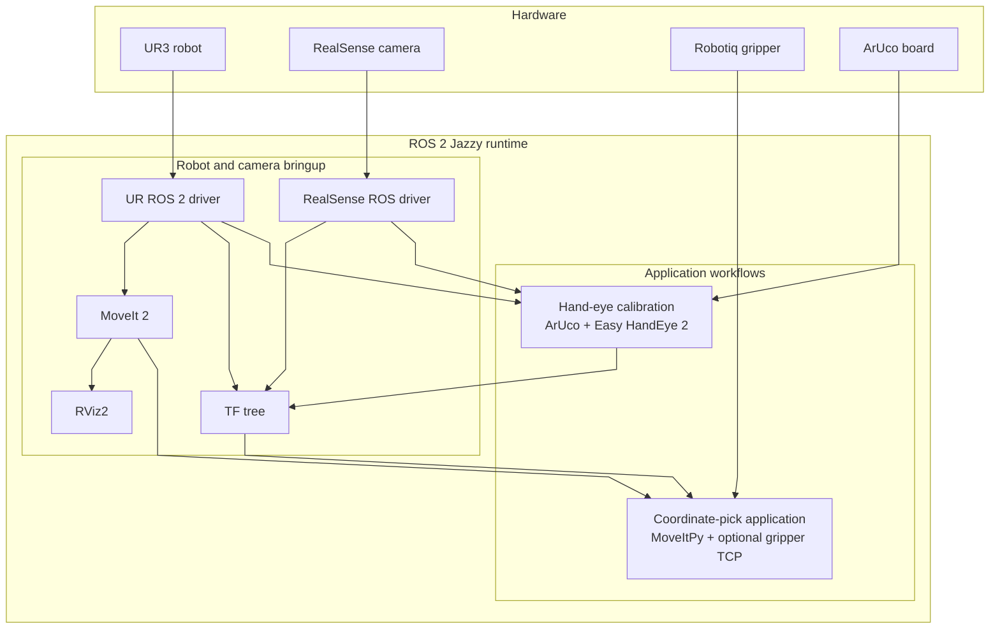
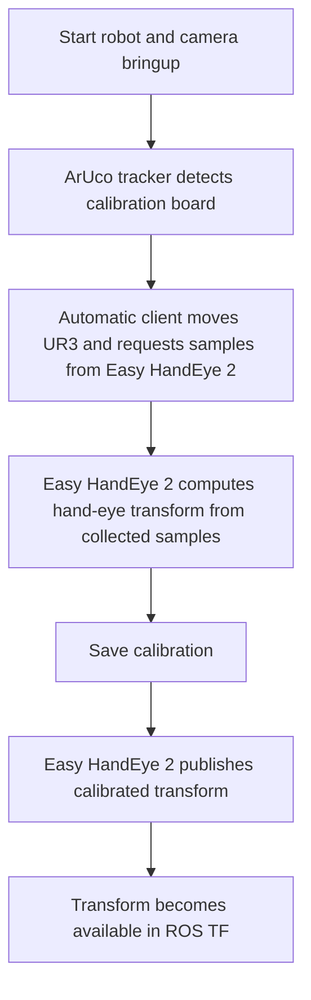
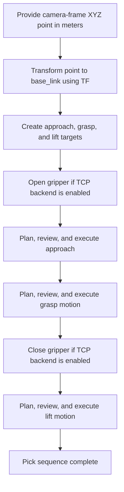

# UR3 System Architecture

This is the runtime system created by following the setup, calibration, and coordinate-pick procedures. It describes how the hardware and ROS 2 nodes work together, rather than the repository's file and folder layout. The diagrams use straight connectors and separate the system overview from the two operating workflows.

## Hand-eye calibration workflow

## Coordinate-pick workflow

## Operating modes

### 1. Robot and camera bringup

`ur3_bringup` starts the UR driver, MoveIt/RViz2, and RealSense driver. This establishes the robot and camera runtime. It does not start the ArUco tracker or Easy HandEye 2 calibration process.

### 2. Hand-eye calibration

The calibration procedure runs on top of robot and camera bringup. The RealSense image is consumed by the ArUco tracker, which publishes the calibration marker pose. Easy HandEye 2 combines marker observations with UR base/tool poses. The automatic calibration client uses MoveItPy to visit poses and calls Easy HandEye 2 services to collect samples, compute the transform, and save it. The Easy HandEye 2 publisher then inserts the saved camera-to-robot transform into TF.

### 3. Coordinate-based pick

The pick application accepts a 3-D point already expressed in the configured camera frame. TF converts it into `base_link`; the application preserves the current `tool0` orientation and creates approach, grasp, and lift targets. MoveItPy plans each target, the operator checks each plan in RViz2 and confirms before execution, and the UR driver sends the trajectory to the arm. The optional gripper backend controls Robotiq directly over TCP.

## System boundaries

- Calibration establishes the camera-to-robot transform used by the pick application; calibration is a setup workflow and need not run while picking if the transform is already being published or otherwise available in TF.
- The current pick application does not perform image detection, pixel-to-3-D conversion, grasp-pose estimation, or grasp-success verification. A perception system could supply the camera-frame XYZ input in a future integration.

